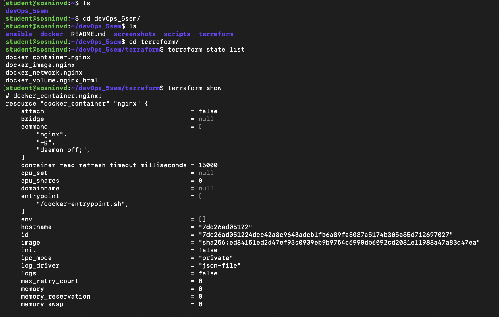
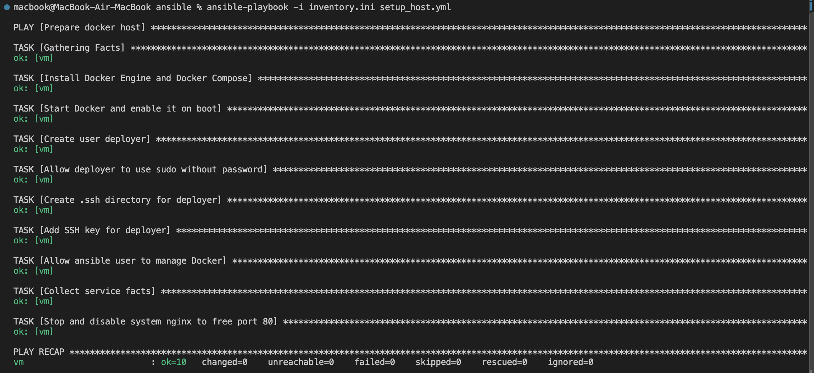
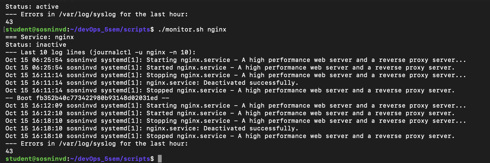
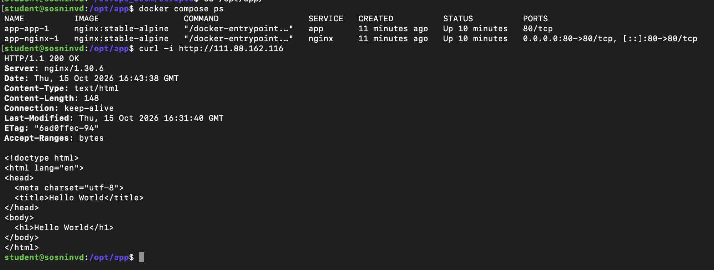

# ДЗ 1: Фундамент DevOps-инфраструктуры

## Структура

| Путь | Назначение |
| --- | --- |
| `ansible/` | inventory и playbook настройки VM |
| `terraform/` | контейнер nginx с отдельной сетью и томом |
| `scripts/monitor.sh` | мониторинг сервиса и ошибок в syslog |
| `docker/` | Docker Compose: nginx (reverse proxy) и app |

## Установка и запуск

1. Настройка VM (с локальной машины):

```bash
cd ansible
ansible-playbook -i inventory.ini setup_host.yml
```

2. Terraform (на VM):

```bash
cd terraform
terraform init
terraform apply
terraform state list
curl -i http://127.0.0.1:8081
```

3. Мониторинг (на VM):

```bash
./scripts/monitor.sh docker
```

4. Docker Compose (на VM):

```bash
sudo install -d -o deployer -g deployer /opt/app
sudo cp docker/* /opt/app/
cd /opt/app
docker compose up -d
docker compose ps
curl -i http://111.88.162.116
```

## Результаты

### terraform state list



### Ansible, второй запуск



### monitor.sh



### docker compose ps и curl



## Архитектурные решения

- Сначала Ansible ставит Docker, затем Terraform через провайдер `kreuzwerker/docker` создаёт сеть `tf_nginx_net`, том `tf_nginx_html` и контейнер nginx на порту 8081.
- Ansible создаёт пользователя `deployer` с sudo без пароля и входом по SSH-ключу, ставит `docker.io` и `docker-compose-v2`, включает автозапуск Docker. Используются модули с проверкой состояния, поэтому повторный запуск даёт `changed=0`.
- Сервисы Compose работают в своей сети `app_net`. Наружу открыт только порт 80 reverse proxy, контейнер `app` доступен только внутри сети.
- Nginx из Terraform слушает `127.0.0.1:8081`, чтобы не открывать лишний порт наружу.
- State Terraform хранится на VM и не добавляется в git.

## Проблемы и решения

- Сайты HashiCorp недоступны из РФ: Terraform и провайдер скачаны с зеркала Yandex Cloud (`~/.terraformrc`).
- Порт 80 был занят системным nginx: Ansible останавливает его и отключает автозапуск.
